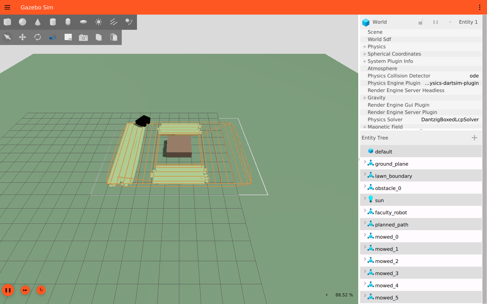
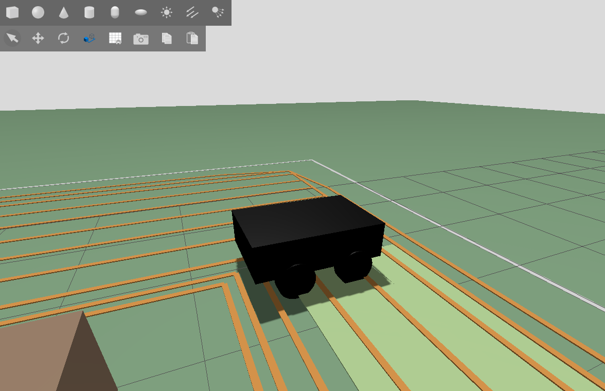
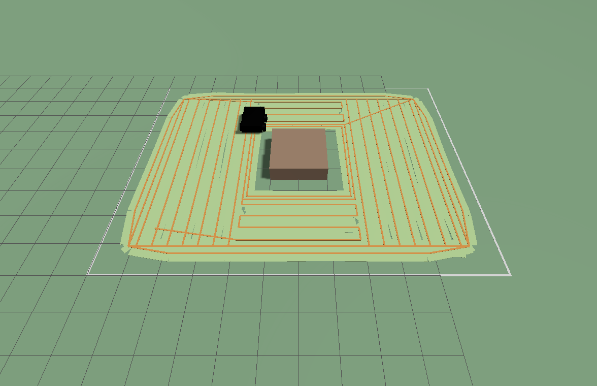
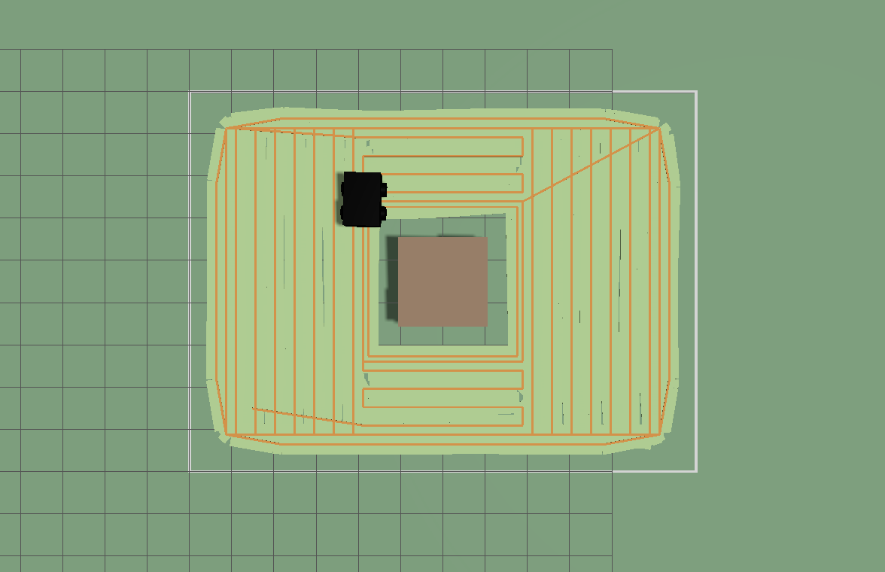
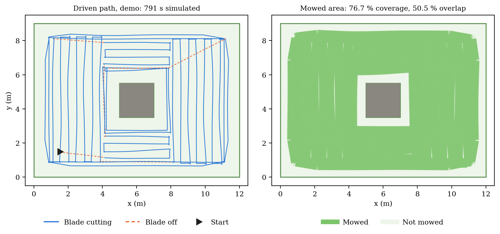
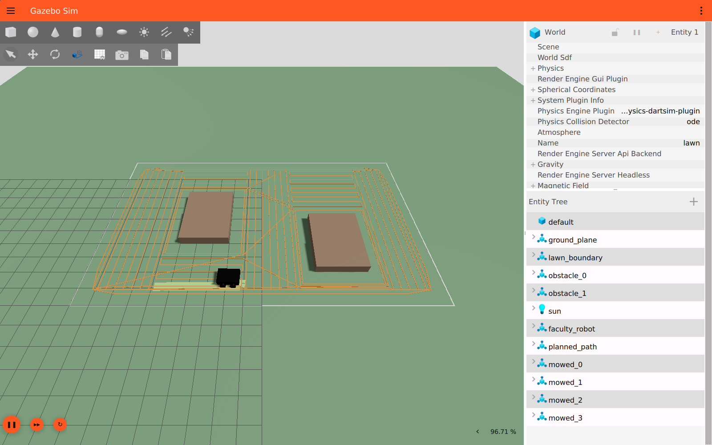
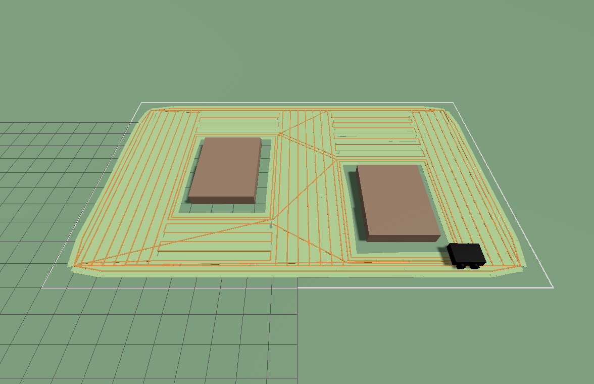
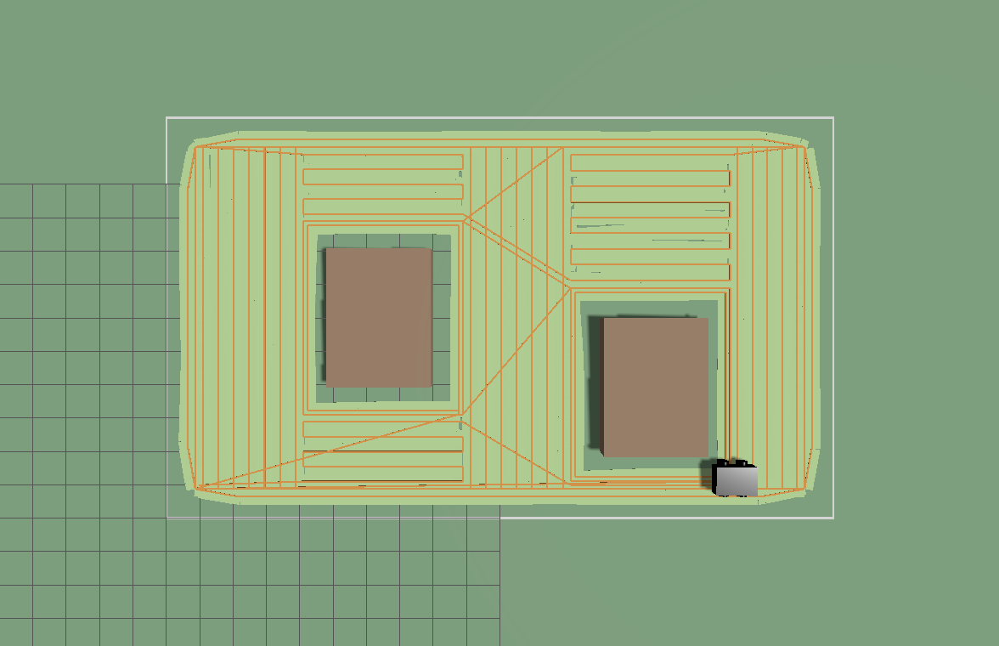
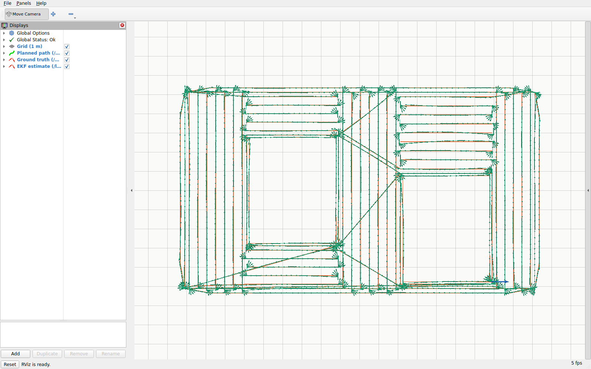
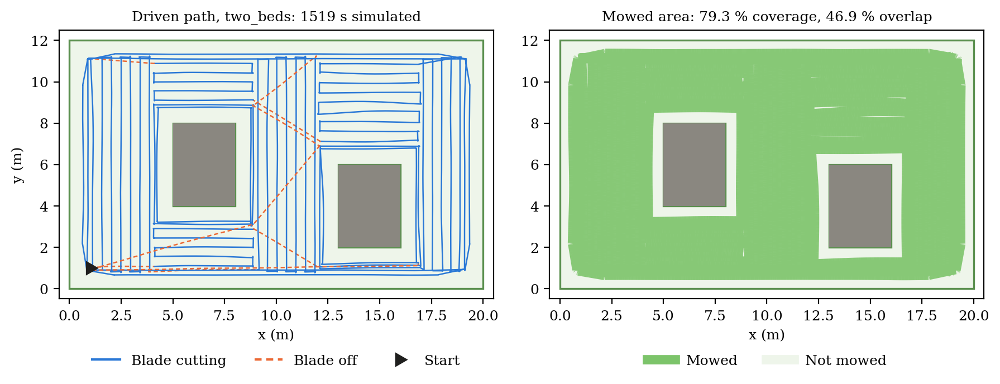

# Documentation

Screenshots of the Gazebo simulation, the results of the runs they come from, and the tools that made them.

All runs use the `faculty_robot_estimate` robot config, the `faculty_robot` electronics config, the `energy_ga` ordering with seed 0 and the `hybrid` pattern (lanes, then contour passes along the edges). They show that the simulation works. They are not results for the paper.

## Contents

| Image | What it shows |
| --- | --- |
| [`gazebo-gui.png`](images/gazebo-gui.png) | The Gazebo window during a run on the `demo` lawn. |
| [`demo-closeup.png`](images/demo-closeup.png) | The robot mowing a lane. |
| [`demo-oblique.png`](images/demo-oblique.png), [`demo-top.png`](images/demo-top.png) | The `demo` lawn after the run. |
| [`demo-coverage.png`](images/demo-coverage.png) | The driven path and the mowed area of the `demo` run, from the evaluator's trajectory. |
| [`two-beds-gui.png`](images/two-beds-gui.png) | The start of the run on the `two_beds` lawn. |
| [`two-beds-oblique.png`](images/two-beds-oblique.png), [`two-beds-top.png`](images/two-beds-top.png) | The `two_beds` lawn after the run. |
| [`two-beds-rviz.png`](images/two-beds-rviz.png) | RViz: the planned path, the true path and the EKF estimate of the `two_beds` run. |
| [`two-beds-coverage.png`](images/two-beds-coverage.png) | The driven path and the mowed area of the `two_beds` run. |

The figures of the paper are in [`paper/figures/`](../paper/figures). The scripts in [`paper/scripts/`](../paper/scripts) make them.

## The simulation

```bash
ros2 launch lawn_mower_navigation coverage_sim.launch.py lawn:=demo
```

The launch starts Gazebo with the lawn and the robot, the electronics models, the localisation, the mission and the evaluator. A scripted operator switches the radio to automatic mode, the robot mows the lawn, and the evaluator writes `mission.csv` and `trajectory.csv`. See [`src/lawn_mower_navigation/README.md`](../src/lawn_mower_navigation/README.md).

In the screenshots:

- The white line is the lawn edge. The brown boxes are the flower beds.
- The black box on four wheels is the robot.
- The thin orange lines are the planned path (`/mission/path`).
- The light green strips are where the blade cut: the true path, widened by the 0.5 m cutting width, while the blade ran.

The orange and green strips are not part of the simulation. `tools/gazebo_overlay.py` adds them for the screenshots, as static models with no collision.

### The Gazebo window



The robot has mowed the lanes of the left cell and of the cells above and below the bed. The entity tree on the right lists the lawn edge, the bed, the robot, the planned path and the batches of mowed strips.



The robot drives a lane with the blade on. The strip behind it is mowed. The robot turns in place at each end of a lane.

### The `demo` lawn

A 12 m × 9 m lawn with one 2 m × 2 m bed.





The lanes cover the four cells round the bed. Then the contour passes cut along the lawn edge and round the bed. A strip along the edge and round the bed stays uncut: the robot body is 1.02 m wide and must stay inside the lawn, so the 0.5 m blade cannot reach the edge.



Left: the path the robot drove, with the blade on (blue) and off (orange). The blade is off on long moves between cells. Right: the mowed area.

### The `two_beds` lawn

A 20 m × 12 m lawn with two beds.









In RViz, the orange line is the planned path, the green arrows are the true pose from Gazebo, and the blue arrow is the pose of the EKF (`/localization/odom`) at the end of the run. The config is [`tools/mission.rviz`](tools/mission.rviz).



## Results of the runs

Runs with the Gazebo window, real-time factor about 0.9:

| Result | `demo` | `two_beds` |
| --- | --- | --- |
| Coverage, planned and simulated | 77.2 % and 76.9 % | 79.6 % and 79.5 % |
| Overlap, simulated | 50.5 % | 46.9 % |
| Path length, planned and driven | 260.5 m and 266.9 m | 559.3 m and 568.9 m |
| Duration, simulated | 789 s | 1517 s |
| Tracking error, mean and largest | 0.02 m and 0.13 m | 0.01 m and 0.13 m |
| Localisation error, mean and largest | 0.02 m and 0.07 m | 0.01 m and 0.07 m |
| Body past the lawn edge, at most | 0.005 m | 0.011 m |
| Energy: traction, blade, auxiliary | 8.5, 97.6, 3.3 Wh | 16.1, 186.4, 6.3 Wh |
| Battery left | 95.7 % | 91.8 % |

The results match the headless reference runs in [`src/lawn_mower_navigation/README.md`](../src/lawn_mower_navigation/README.md#reference-runs) to within 0.2 percentage points of coverage and 3 % of duration.

The planned coverage is what the planner expects from the plan. The simulated coverage is what the evaluator measures on the true path. They agree within 0.5 percentage points. Overlap is high in the hybrid pattern, because the contour passes run over the ends of the lanes.

The blade takes about 90 % of the energy: the simulation does not model grass, so the blade draws its full cutting power whenever it spins.

`mission.csv` and `trajectory.csv` of each run are in [`results/demo/`](results/demo) and [`results/two_beds/`](results/two_beds).

## The electronics in the run

The controller starts in `FAILSAFE` until the receiver has a frame, then goes to `MANUAL`, because the mode switch is low. The mission plans and waits. When the scripted operator puts the mode switch to automatic, the controller goes to `AUTO` and the mission starts. From the `demo` run:

```text
[controller]: Controller state: FAILSAFE
[controller]: Controller state: MANUAL
[mission]: Plan (hybrid): 4 cells, 73 segments, 260.5 m, 72 turns, 10.92 Wh traction, planned coverage 77.2 %, clearance 0.89 m, planned in 2.5 s
[mission]: Mission WAITING
[rc_transmitter]: Operator: mode switch to automatic, blade switch on
[controller]: Controller state: AUTO
[mission]: Mission RUNNING
[mission]: Mission DONE
[evaluator]: Written to /tmp/results_demo/mission.csv
```

### Safety check

With a `demo` run in the Gazebo window, `safety_check` played the operator: it took over by radio, switched the transmitter off and pressed the emergency stop. All 10 steps passed ([`results/safety-check.txt`](results/safety-check.txt)):

```text
ok   mowing in automatic mode                     controller AUTO     mission RUNNING speed 0.33 m/s blade 5008 rpm
ok   operator switches to manual, sticks centred  controller MANUAL   mission PAUSED  speed 0.00 m/s blade 5994 rpm
ok   operator pushes the throttle                 controller MANUAL   mission PAUSED  speed 0.63 m/s blade 6000 rpm
ok   operator switches back to automatic          controller AUTO     mission RUNNING speed 0.01 m/s blade 6000 rpm
ok   transmitter off: radio link lost             controller FAILSAFE mission PAUSED  speed 0.00 m/s blade   21 rpm
ok   transmitter back on                          controller AUTO     mission RUNNING speed 0.00 m/s blade 6000 rpm
ok   emergency stop pressed                       controller ESTOP    mission PAUSED  speed 0.00 m/s blade   12 rpm
ok   emergency stop released: still latched       controller ESTOP    mission PAUSED  speed 0.00 m/s blade    0 rpm
ok   operator re-arms by switching to manual      controller MANUAL   mission PAUSED  speed 0.00 m/s blade 5482 rpm
ok   operator switches to automatic again         controller AUTO     mission RUNNING speed 0.46 m/s blade 6000 rpm
All 10 steps passed
```

- In manual mode the mission pauses, and the sticks drive the robot. The blade keeps running, because the operator's blade switch is on.
- A lost radio link stops the drive and the blade. When the link returns with the mode switch high, the mission continues.
- After the emergency stop is released, the stop stays latched until the operator puts the mode switch to manual.

To run it: start `coverage_sim.launch.py`, then `ros2 run lawn_mower_navigation safety_check --ros-args -p use_sim_time:=true`.

## How the screenshots were made

The runs used a container with the packages of the dev container image: ROS 2 Lyrical, Gazebo through `ros_gz`, RViz and the Python packages. The Gazebo window ran on a virtual display (Xvfb, 1600 × 1000) with software OpenGL (Mesa llvmpipe), at a real-time factor of about 0.9.

1. Start a virtual display, if there is no screen:

   ```bash
   Xvfb :99 -screen 0 1600x1000x24 +extension GLX &
   export DISPLAY=:99 LIBGL_ALWAYS_SOFTWARE=1
   ```

2. Start the run, and when the robot is in Gazebo, the overlay:

   ```bash
   ros2 launch lawn_mower_navigation coverage_sim.launch.py lawn:=two_beds auto_after:=30.0 &
   python3 docs/tools/gazebo_overlay.py &
   ```

3. Optional: RViz. The true pose is in the `world` frame, the plan and the EKF in `map`, so link the two:

   ```bash
   ros2 run tf2_ros static_transform_publisher --frame-id world --child-frame-id map &
   rviz2 -d docs/tools/mission.rviz --ros-args -p use_sim_time:=true &
   ```

4. Move the camera and save the screen with [`tools/screenshots.sh`](tools/screenshots.sh):

   ```bash
   docs/tools/screenshots.sh top 10 6 15                  # straight down on (10, 6) from 15 m
   docs/tools/screenshots.sh camera 10 -4.2 11.5 0 0.9 1.5708
   docs/tools/screenshots.sh follow 2.6 1.6 -0.7          # behind the robot
   docs/tools/screenshots.sh shot docs/images/top.png scene
   ```

5. After the run, plot the trajectory:

   ```bash
   PYTHONPATH=src/lawn_mower_planning:src/lawn_mower_robot:src/lawn_mower_navigation \
       python3 docs/tools/plot_run.py two_beds docs/results/two_beds docs/images/two-beds-coverage.png
   ```

The launch ends when the evaluator has written the results, and Gazebo closes with it a few seconds later. Take the last screenshots as soon as the mission reports `DONE`.

`plot_run.py` scores the trajectory as the evaluator does. It reads the rounded positions of `trajectory.csv`, so its coverage can differ from `mission.csv` by about 0.2 percentage points.
